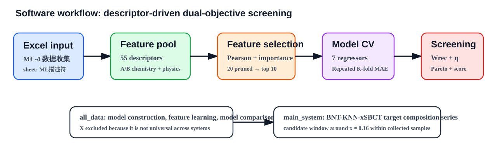
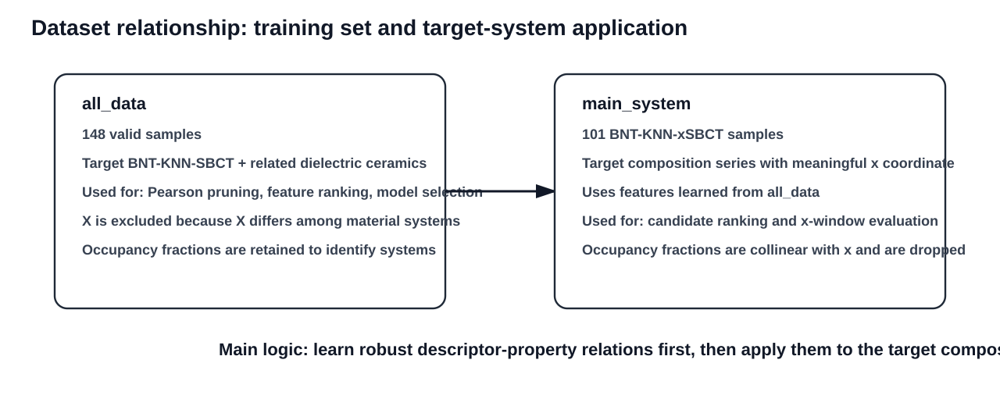
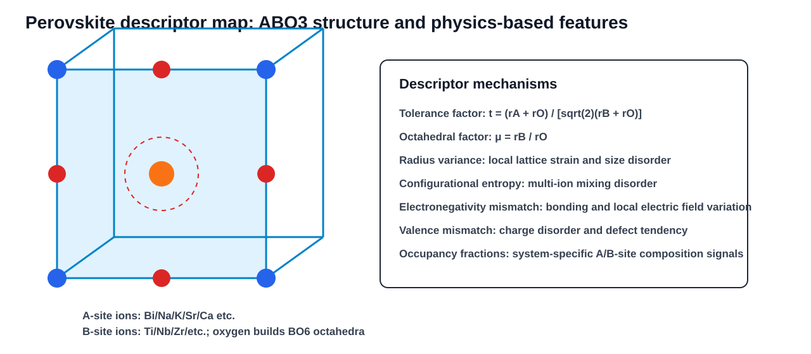
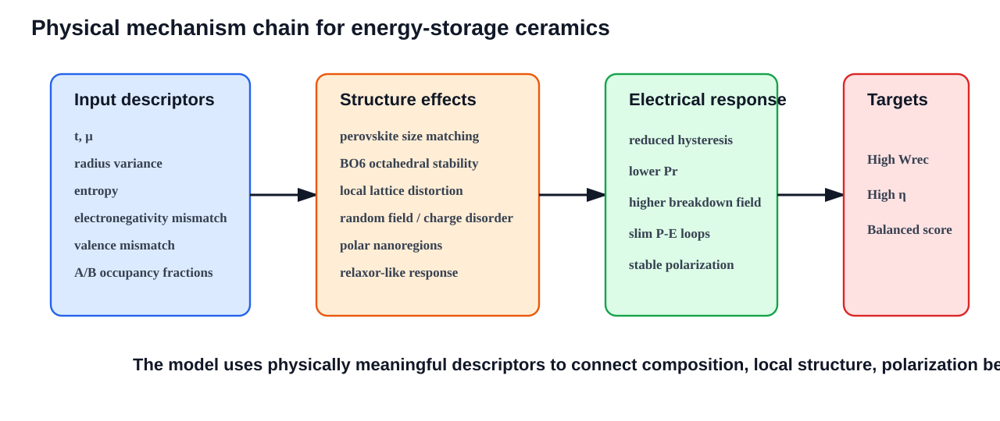
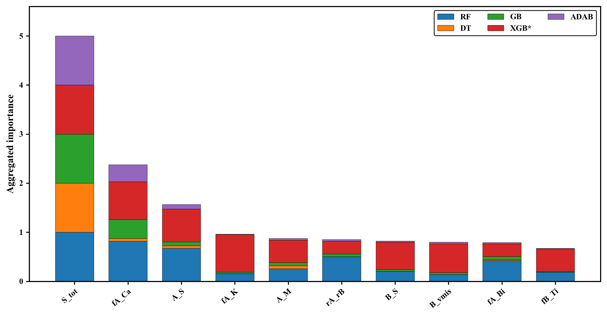
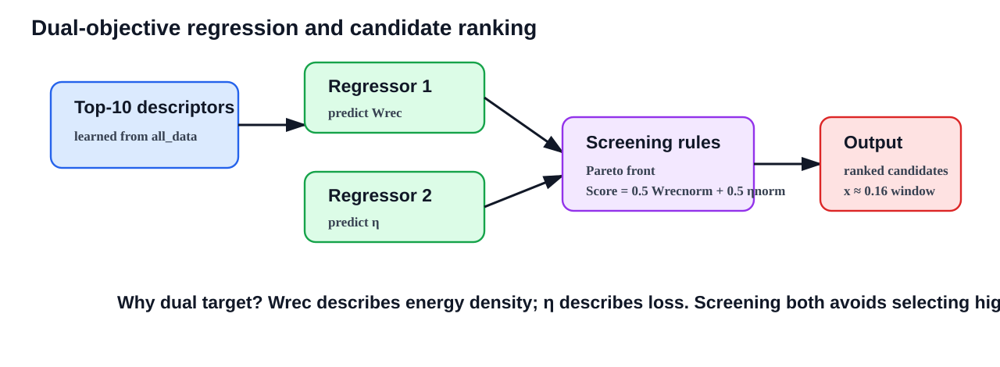
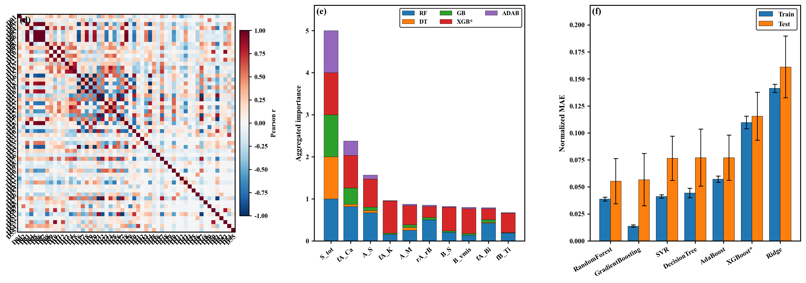
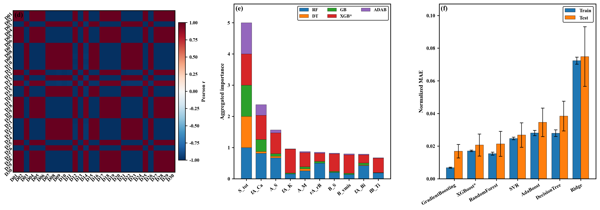
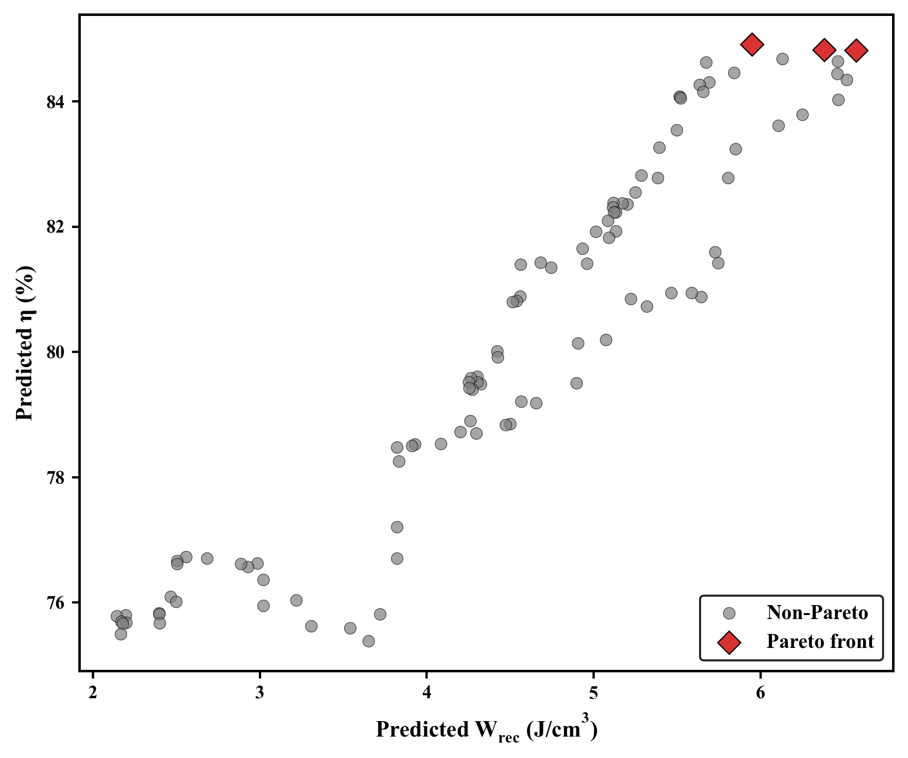
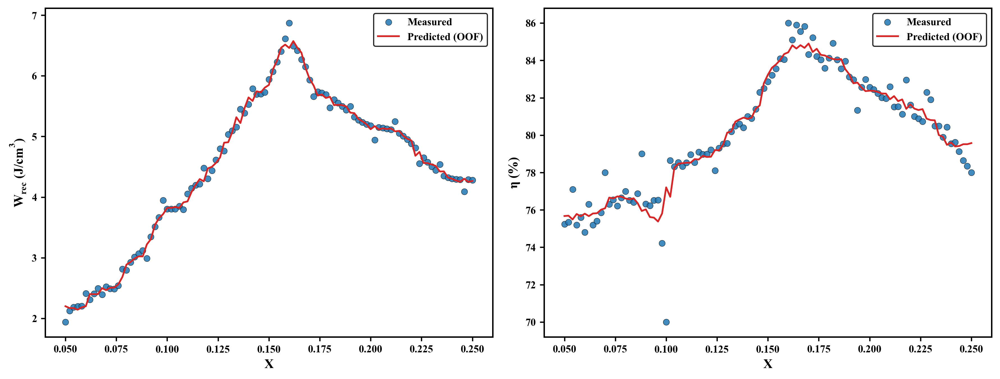

# Material Network: BNT-KNN-xSBCT dielectric ceramic screening

This repository contains a descriptor-driven machine learning workflow for small-sample screening of dielectric energy-storage ceramic compositions. The current implementation focuses on the BNT-KNN-xSBCT target system and related dielectric ceramic systems, using dual-objective regression to evaluate recoverable energy density (`Wrec`) and energy-storage efficiency (`η`) at the same time.

> Scope note: this project is a small-sample, descriptor-driven screening tool. It identifies promising candidates within the collected dataset and the measured BNT-KNN-xSBCT composition series. It is not a universal predictor for all ceramic composition space and should not be interpreted as a global optimization framework.



## 1. What the software does

The main script is [`ml_change.py`](ml_change.py). It reads the Excel dataset, constructs physical descriptors, performs feature selection, compares multiple regression models, and ranks candidate compositions using a dual-objective `Wrec-η` strategy.

Core tasks:

1. Read `ML-4-数据收集.xlsx`.
2. Use the `ML描述符` sheet as the machine-learning descriptor table.
3. Build and clean the descriptor matrix.
4. Split outputs into two scopes:
   - `all_data`: all valid descriptor rows, used for descriptor learning and model comparison.
   - `main_system`: BNT-KNN-xSBCT target composition series, used for candidate-window evaluation.
5. Apply Pearson correlation pruning to reduce redundant descriptors.
6. Aggregate feature importance from tree-based models and select top descriptors.
7. Compare regression models with repeated K-fold cross-validation.
8. Train separate models for `Wrec` and `η`.
9. Rank samples by Pareto-front membership and normalized combined score.
10. Export figures, tables, candidate rankings, and model summaries.

## 2. Repository structure

```text
.
├── ML-4-数据收集.xlsx               # Input descriptor dataset
├── ml_change.py                    # Main machine-learning pipeline
├── code_versions/                  # Separated historical/current code versions
│   ├── 01_wrec_only_feature_selection/
│   │   └── ml_change_wrec_only.py   # Previous Wrec-only feature-selection version
│   └── 02_wrec_eta_dual_feature_selection/
│       ├── ml_v2_wrec_eta.py        # Updated Wrec+η feature-selection workflow
│       └── wrec_eta_dual_feature_selection.py
├── requirements.txt                # Python dependencies
├── README.md                       # Project description
├── docs/
│   └── images/                     # Mechanism and workflow illustrations
├── output/
│   ├── all_data/                   # Full dataset modeling outputs
│   └── main_system/                # Target BNT-KNN-xSBCT system outputs
└── outputs/                        # Earlier output folder kept for reference
```

## 2.1 Code version distinction

Two code versions are kept under [`code_versions/`](code_versions/) to make the
method evolution explicit:

- [`01_wrec_only_feature_selection`](code_versions/01_wrec_only_feature_selection/):
  previous workflow. The top-10 feature selection is driven mainly by `Wrec`.
  The eta model is used later for prediction and auxiliary scoring, but eta is
  not used to rank the top-10 descriptors.
- [`02_wrec_eta_dual_feature_selection`](code_versions/02_wrec_eta_dual_feature_selection/):
  updated workflow. The top-10 feature selection combines `Wrec` and eta with
  the default weighting `0.70 * Wrec + 0.30 * eta`, so `Wrec` remains the
  primary target while eta contributes as an auxiliary screening target.

## 3. Dataset strategy: all_data and main_system

The project uses a two-stage dataset strategy instead of treating `all_data` and `main_system` as two unrelated tasks.



### all_data

`all_data` contains all valid rows from the ML descriptor table. In the current version, it contains 148 samples. It includes the BNT-KNN-xSBCT target system and related dielectric energy-storage ceramic systems.

Its role is to build a more stable descriptor-property relationship under limited target-system data. It is used for:

- descriptor screening;
- Pearson redundancy pruning;
- feature-importance ranking;
- model comparison;
- dual-objective regression strategy construction.

In `all_data`, the composition variable `X` is excluded from input features because `X` does not have the same physical meaning across different material systems. A/B-site occupancy fractions are retained because they help distinguish between related ceramic systems.

### main_system

`main_system` is the BNT-KNN-xSBCT target composition series. In the current version, it contains 101 target-system samples.

Its role is not to rebuild the full feature-selection workflow independently. Instead, it uses the descriptors learned from `all_data` and applies the trained logic to the target composition series. This avoids misleading feature rankings caused by the fact that many descriptors in a one-dimensional `x` series vary monotonically with `x`.

In short:

```text
all_data learns the descriptor-property rules.
main_system applies those rules to the BNT-KNN-xSBCT composition series.
```

## 4. Physical descriptor mechanisms

The descriptor design is not only a numerical feature expansion. It is intended to encode physical factors that are relevant to perovskite dielectric energy-storage ceramics.



### 4.1 A/B-site weighted-average descriptors

The workflow includes A-site and B-site weighted-average ionic descriptors. These descriptors describe geometric, electronic, bonding, and polarizability characteristics of mixed-site compositions. They include features such as ionic radius, atomic mass, polarizability, ionization energy, and electronegativity.

Physical meaning:

- A-site descriptors mainly describe large-cation size matching, mass, charge environment, and configurational mixing.
- B-site descriptors are closely related to BO6 octahedra, local polar units, and polarization response.
- A/B combined descriptors help connect composition variation to lattice distortion and dielectric response.

### 4.2 Tolerance factor

The tolerance factor describes A-site, B-site, and oxygen size matching in ABO3 perovskites:

```text
t = (rA + rO) / [sqrt(2) * (rB + rO)]
```

It reflects whether the perovskite lattice is geometrically favorable. A deviation from ideal size matching may induce structural distortion, phase instability, or enhanced local disorder.

### 4.3 Octahedral factor

The octahedral factor is defined as:

```text
μ = rB / rO
```

It describes the size compatibility between B-site cations and oxygen in BO6 octahedra. It is related to octahedral stability, local polar-unit formation, and lattice distortion.

### 4.4 Radius variance and size mismatch

Radius variance measures how strongly different ions on the same crystallographic site deviate from the average ionic radius:

```text
σ_r^2 = Σ x_i * (r_i - r_mean)^2
```

A larger radius variance generally implies stronger local strain, stronger lattice distortion, and enhanced structural disorder. In relaxor-like dielectric ceramics, this type of disorder can contribute to polar nanoregions, slim polarization-electric field loops, and improved efficiency.

### 4.5 Configurational entropy

Configurational entropy describes the mixing complexity of multiple ions:

```text
ΔS_config = -R * Σ x_i ln(x_i)
```

The script considers A-site, B-site, and total configurational entropy terms. Higher configurational entropy indicates stronger multi-ion disorder, which can be connected to random-field effects, disrupted long-range ferroelectric order, and enhanced relaxor behavior.

### 4.6 Electronegativity mismatch

Electronegativity mismatch describes chemical bonding heterogeneity among A-site, B-site, and oxygen-related environments. It can reflect local bonding differences, local electric-field variation, and polarization response differences.

### 4.7 Valence mismatch

Valence mismatch describes charge disorder caused by mixed-valence occupation. It is related to defect tendency, charge compensation, local random fields, and possible changes in breakdown behavior.

### 4.8 From descriptors to energy-storage performance



These mechanisms are connected to dielectric energy storage through the following chain:

```text
Composition and ionic descriptors
→ lattice size matching and local distortion
→ random fields, polar nanoregions, and relaxor-like response
→ slim P-E loops, reduced remanent polarization, and enhanced breakdown field
→ improved Wrec and η
```

The model therefore does not only fit numbers. It attempts to use physically interpretable descriptors to connect composition, local structure, polarization behavior, and macroscopic energy-storage performance.

## 5. Feature selection mechanism

The script first removes invalid or constant features. Pearson correlation analysis is then used to remove redundant descriptors. The current threshold is:

```text
|r| > 0.85
```

The retained descriptors are then ranked using aggregated feature importance from multiple tree-based models:

- Random Forest (`RF`)
- Decision Tree (`DT`)
- Gradient Boosting (`GB`)
- Extra Trees (`XGB*`, used as an XGBoost-like tree-ensemble surrogate)
- AdaBoost (`ADAB`)

The current top descriptors in `all_data` are:

| Rank | Descriptor alias | Meaning |
|---:|---|---|
| 1 | `S_tot` | total configurational entropy |
| 2 | `fA_Ca` | A-site Ca fraction |
| 3 | `A_S` | A-site configurational entropy |
| 4 | `fA_K` | A-site K fraction |
| 5 | `A_M` | A-site average atomic mass |
| 6 | `rA_rB` | A/B average radius ratio |
| 7 | `B_S` | B-site configurational entropy |
| 8 | `B_vmis` | B-site valence mismatch |
| 9 | `fA_Bi` | A-site Bi fraction |
| 10 | `fB_Ti` | B-site Ti fraction |

Feature-importance output:



## 6. Dual-objective regression mechanism

The project uses two independent regression models with the same selected descriptor set:

- Model 1 predicts `Wrec`.
- Model 2 predicts `η`.



This is different from a single-target `Wrec` workflow. A high `Wrec` value alone does not guarantee good practical energy-storage performance if the efficiency is low. The dual-objective design supports candidate selection based on both energy density and loss.

Candidate ranking uses two auxiliary criteria:

1. Pareto-front screening: candidates not simultaneously dominated in predicted `Wrec` and predicted `η`.
2. Normalized combined score:

```text
Score = 0.5 * Wrec_norm + 0.5 * η_norm
```

Equal weighting is used to avoid overemphasizing either energy density or efficiency.

## 7. Current model-selection results

### all_data

- Samples: 148
- Initial descriptors: 55
- Pearson-pruned descriptors: 20
- Selected model for `Wrec`: RandomForest
- Cross-validated `Wrec` MAE: approximately 0.320 J/cm3
- Selected model for `η`: RandomForest
- Cross-validated `η` MAE: approximately 3.22%



### main_system

- Samples: 101
- Initial descriptors: 30
- Feature selection reused from `all_data`
- Selected model for `Wrec`: GradientBoosting
- Cross-validated `Wrec` MAE: approximately 0.083 J/cm3
- Selected model for `η`: RandomForest
- Cross-validated `η` MAE: approximately 0.611%

The stronger `main_system` metrics should be interpreted carefully. They mainly reflect interpolation within the measured BNT-KNN-xSBCT composition series, not universal predictive power.



## 8. Candidate screening result

The current target-system candidate evaluation indicates that the composition window around:

```text
x ≈ 0.16
```

shows a favorable balance between predicted `Wrec` and predicted `η` within the collected BNT-KNN-SBCT samples.





This should be described as a promising candidate window in the collected target-system data, not as a global optimum in the unexplored composition space.

## 9. Output files

The script exports figures and tables under `output/`.

Key files in each scope:

```text
Figure1d_Pearson_full.png
Figure1e_feature_importance.png
Figure1f_model_selection_Wrec.png
Figure1f_model_selection_eta.png
Figure1_def_combined.png
Predicted_vs_Measured_Wrec.png
Predicted_vs_Measured_eta.png
Dual_objective_Pareto.png
selected_models.csv / .xlsx
feature_columns_top10.csv / .xlsx
dual_target_scored_samples.csv / .xlsx
pareto_candidates.csv / .xlsx
top20_combined_score_candidates.csv / .xlsx
summary.txt
```

For `main_system`, the script also exports:

```text
X_trends_primary_targets.png
```

## 10. How to run

Create and activate a Python environment, then install dependencies:

```powershell
pip install -r requirements.txt
```

Run the pipeline:

```powershell
python ml_change.py
```

The script uses the local Excel file when available:

```text
ML-4-数据收集.xlsx
```

After running, results are written to:

```text
output/all_data
output/main_system
```

## 11. Interpretation boundary

Recommended wording for manuscripts:

```text
The present model is a small-sample, descriptor-driven screening framework for identifying promising candidates within the collected dielectric ceramic dataset and the BNT-KNN-SBCT target composition series. The candidate around x ≈ 0.16 should be interpreted as a high-potential composition window within the current experimental samples, rather than a global optimum over the entire composition space.
```

中文表述：

```text
本模型是面向小样本介质储能陶瓷数据的描述符驱动筛选工具，用于在当前已收集数据和 BNT-KNN-SBCT 目标体系样本范围内识别有潜力的候选组分。x≈0.16 附近应表述为当前实验样本范围内的高潜力候选组分窗口，而不是整个未知组分空间的全局最优组分。
```

## 12. License and citation

No license is currently assigned. If this repository remains private, use it as an internal research repository. If it is made public later, add an explicit license and citation information.
